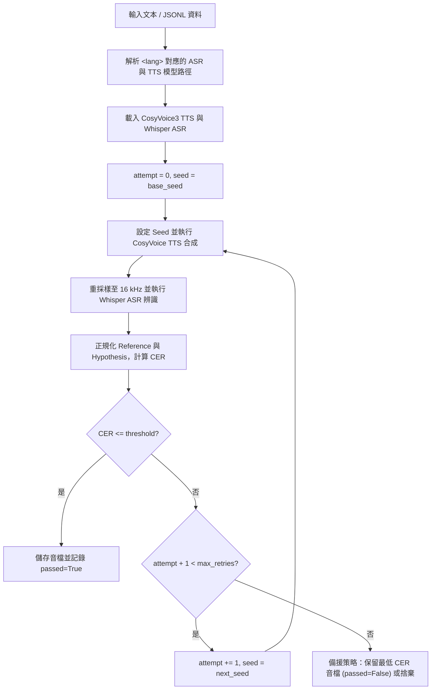

# 實作計畫：TTS + ASR CER 過濾與 Seed 重試生成系統

## 目標說明
在 `/mnt/usr1/avi/Projects/formosan/Filtering` 建立一套模組化的語音合成過濾與重試系統，流程如下：
1. 依語言代碼 `<lang>` 動態載入位於 `/nfs/DGX2/Workspace/avi/fb_nchc/asr/<lang>/models` 的 **Whisper ASR** 模型，以及位於 `/nfs/DGX2/Workspace/avi/fb_nchc/tts/<lang>/models` 的 **CosyVoice3 TTS** 模型。
2. 使用指定的隨機種子（seed）呼叫 CosyVoice 合成目標文本的語音。
3. 將合成後的音訊送入 Whisper ASR 模型進行辨識，並計算辨識結果與目標文本之間的 **字元錯誤率（CER）**。
4. 若 `CER <= threshold` 則通過並保留音訊；否則更換隨機種子重新生成，直到通過門檻或達到最大重試次數 `max_retries`。

---

## 需使用者確認事項

> [!WARNING]
> **Conda 環境套件衝突（`sarcvoice` 與 `whisper_ft`）**
> 檢查現有環境後發現：
> - `sarcvoice`（`torch 2.3.1+cu121`、`transformers 4.51.3`）目前安裝了 `numpy 2.2.6`，會導致 CosyVoice 所需的 `onnxruntime-gpu 1.18.0` 在匯入時發生 `AttributeError: _ARRAY_API not found` 錯誤。
> - `whisper_ft`（`torch 2.5.1+cu121`、`transformers 5.14.1`、`jiwer`、`librosa`、`soundfile`）可正常執行 Whisper ASR 與 CER 計算。
>
> **建議方案**：將 `sarcvoice` 降版為 `numpy<2`（或建立一個專用的 `filtering` conda 環境），讓 CosyVoice TTS 與 Whisper ASR 在同一個 GPU 行程中執行；或者透過獨立的 subprocess worker 分別在 `sarcvoice` 與 `whisper_ft` 執行，以保持現有環境不變。

> [!IMPORTANT]
> **目前磁碟上的模型狀態**
> - ASR 模型：`pyu`、`trv`、`tsu` 皆已有模型。
> - TTS 模型：`tsu` 已有模型（`tsu/models/tsu123`），而 `pyu/models` 與 `trv/models` 目前為空目錄。
>
> 模型路徑解析器（`model_resolver.py`）會支援所有 `<lang>` 目錄；若該語言的 `models/` 為空，會在啟動時立即回報清楚的錯誤訊息。

---

## 待確認問題

1. **環境策略**：要將 TTS 與 ASR 整合在同一個 conda 環境執行（例如在 `sarcvoice` 降版 `numpy<2` 並補齊套件，或新建一個環境），還是透過常駐 subprocess worker 分別呼叫 `sarcvoice` 與 `whisper_ft`？
2. **TTS 模式與 Prompt 預設值**：是否預設採用 `zero_shot` 模式（與 `cosyvoice/batch_inference.py`、`simple_inference.py` 相同），優先從 `.jsonl` 讀取每筆資料的 `prompt_wav` / `prompt_text`，並提供 CLI 預設值作為備援？
3. **超過最大重試次數的處理方式**：若所有 `max_retries` 個 seed 都無法讓 `CER <= threshold`，是否保留 **CER 最低**的那一筆音訊並標記 `"passed": false`（建議），還是直接捨棄不輸出？
4. **CER 計算前的文本正規化**：計算 `jiwer.cer` 前，是否比照 `asr/tsu/tsu_quantative.md` 的 `Post-TN` 格式進行小寫化與去除標點符號？

---

## 系統架構流程圖



---

## 預計新增檔案與修改內容

所有新程式碼將建立於 `/mnt/usr1/avi/Projects/formosan/Filtering`。

### 設定與資料結構

#### [NEW] [config.py](file:///mnt/usr1/avi/Projects/formosan/Filtering/src/filtering/config.py)
定義型別化的 dataclass：
- `FilterConfig`：`lang`、`asr_root`、`tts_root`、`asr_model_name`、`tts_model_name`、`cer_threshold`（如 `0.15`）、`max_retries`（如 `5`）、`base_seed`（如 `42`）、`tts_mode`（`zero_shot` | `instruct2`）、`default_prompt_wav`、`default_prompt_text`、`normalize_text`（`True`）、`keep_best_on_fail`（`True`）、`device`。
- `AttemptResult`：`attempt`、`seed`、`cer`、`hypothesis`、`audio_path`、`duration_sec`。
- `FilterResult`：`text`、`normalized_ref`、`passed`、`best_attempt`、`attempts: list[AttemptResult]`。

---

### 模型路徑解析器

#### [NEW] [model_resolver.py](file:///mnt/usr1/avi/Projects/formosan/Filtering/src/filtering/model_resolver.py)
自動相容 `/nfs/DGX2/Workspace/avi/fb_nchc/{asr,tts}/<lang>/models` 底下觀察到的兩種目錄結構：
- **扁平結構**（例如 `asr/tsu/models/config.json` + `model.safetensors`）：直接回傳 `models/`。
- **子目錄結構**（例如 `asr/pyu/models/pyu_asr_20261115/`、`asr/trv/models/whisper-large-v3-turbo-trv/`、`tts/tsu/models/tsu123/`）：掃描包含 `config.json`（Whisper）或 `cosyvoice3.yaml` / `llm.pt`（CosyVoice）的子目錄。若有指定 `model_name` 則精確選取該子目錄；若未指定且僅有一個有效模型目錄則自動選取；若為空或有多個候選目錄則拋出明確錯誤。

---

### TTS 與 ASR 推論引擎

#### [NEW] [tts_engine.py](file:///mnt/usr1/avi/Projects/formosan/Filtering/src/filtering/tts_engine.py)
- 將 `cosyvoice` 與 `cosyvoice/third_party/Matcha-TTS` 加入 `sys.path`（可透過 `--cosyvoice_repo` 設定，預設為 `/mnt/usr1/avi/Projects/formosan/cosyvoice`）。
- 使用 `AutoModel(model_dir=...)` 載入模型。
- 每次合成前呼叫 `set_all_random_seed(seed)`（控制 CosyVoice3 的 LLM token 取樣隨機性；`CausalConditionalCFM` 的 flow noise 僅於 `__init__` 初始化一次）。
- 支援 `inference_zero_shot(..., stream=False, text_frontend=False)` 與 `inference_instruct2(...)`，回傳音訊 tensor 與 `sample_rate`。

#### [NEW] [asr_engine.py](file:///mnt/usr1/avi/Projects/formosan/Filtering/src/filtering/asr_engine.py)
- 從解析後的 ASR 目錄載入 `WhisperProcessor` 與 `WhisperForConditionalGeneration` 至 GPU（CUDA 使用 `torch.float16`，CPU 使用 `float32`）。
- 檢查 `generation_config.json` 是否包含 `<|formosan|>`（`pyu` 為 `51866`），若無則沿用模型預設生成設定（`tsu` 與 `trv` 的情況）。
- 在記憶體中將 TTS 輸出音訊重採樣至 `16000 Hz`（透過 `torchaudio.functional.resample`），執行 `.generate()` 並解碼辨識文字。
- 使用 `jiwer.cer(ref, hyp)` 計算 CER，並支援選擇性的 Post-TN 文本正規化（小寫化、去除標點符號並保留族語喉塞音符號如 `ʼ` / `'`、合併多餘空白）。

---

### 過濾流程與 CLI 介面

#### [NEW] [pipeline.py](file:///mnt/usr1/avi/Projects/formosan/Filtering/src/filtering/pipeline.py)
- 實作 `TTSFilterPipeline.filter_utterance(text, prompt_wav, prompt_text, output_stem)`：
  - 依序執行 `attempt = 0 .. max_retries - 1`，每次使用 `seed = base_seed + attempt`。
  - 呼叫 TTS 合成候選音檔、送入 ASR 辨識並計算 CER。
  - 一旦 `cer <= cer_threshold` 即提前結束，儲存通過的 `.wav` 並回傳 `FilterResult(passed=True, ...)`。
  - 若所有重試皆超過 `cer_threshold`，依 `keep_best_on_fail` 設定決定儲存 CER 最低的候選音檔（`passed=False`）或捨棄。

#### [NEW] [run_filter.py](file:///mnt/usr1/avi/Projects/formosan/Filtering/scripts/run_filter.py)
提供兩種執行模式的 CLI 入口：
- **單句模式**：`--lang tsu --text "..." --prompt_wav ... --prompt_text ... --cer_threshold 0.15 --max_retries 5`
- **批次 JSONL 模式**：`--lang tsu --input_jsonl ... --output_dir ... --output_jsonl ...`（保留原始 JSONL 欄位，並新增 `tts_audio`、`asr_hypothesis`、`cer`、`seed`、`attempts`、`passed`）。

---

### 單元測試

#### [NEW] [test_model_resolver.py](file:///mnt/usr1/avi/Projects/formosan/Filtering/tests/test_model_resolver.py)
使用 `tmp_path` 測試：扁平 `models/`、巢狀 `models/<subdir>/`、指定 `model_name`、空目錄報錯、以及多個子目錄時的模糊錯誤處理。

#### [NEW] [test_pipeline.py](file:///mnt/usr1/avi/Projects/formosan/Filtering/tests/test_pipeline.py)
使用 mock 的 `TTSEngine` 與 `ASREngine` 驗證：
- 第一次嘗試即通過（`CER <= threshold`）時提前結束。
- Seed 遞增並在後續重試成功時停止。
- 耗盡 `max_retries` 且 `keep_best_on_fail=True` 時正確選出 CER 最低的結果。
- 文本正規化與 CER 計算邏輯。

---

## 驗證計畫

### 自動化測試
1. 執行不需 GPU 與模型權重的單元測試：
   ```bash
   pytest /mnt/usr1/avi/Projects/formosan/Filtering/tests -v
   ```

### 手動 / GPU 整合驗證
1. 驗證三種語言的模型路徑解析（ASR 支援 `tsu`、`pyu`、`trv`；TTS 支援 `tsu`）。
2. 在 GPU 上以 `tsu` 進行端到端實測（抽樣 2–3 筆 `tsu` 語句，設定 `--cer_threshold 0.15 --max_retries 5`），檢查產出的 `.wav` 音檔與 `.jsonl` 紀錄（每次嘗試的 seed、CER 與最終 `passed` 狀態）。
